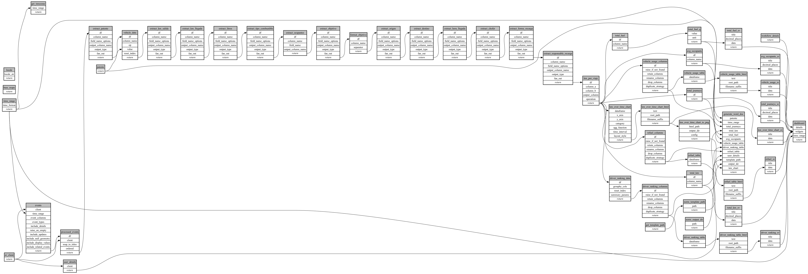

```
# AUTOGENERATED BY ECOSCOPE-WORKFLOWS; see fingerprint in README.md for details

```

```yaml
# fingerprint:
artifacts_sha256_basic: e7103b1317c1507bfab8bf922910aa5f92fd38784e6c958719827aae4c1f4e2e
artifacts_sha256_strict: c4e8d306954051fbca188768d1c8ab6d0d6d256fedc8c61144191a952dd615da
installed_requirements:
- channel: https://repo.prefix.dev/ecoscope-workflows/
  name: ecoscope-platform
  version: {version: ==2.28.0}
- channel: https://repo.prefix.dev/ecoscope-workflows-custom/
  name: ecoscope-workflows-ext-custom
  version: {version: ==0.1.0rc23}
- channel: conda-forge
  name: pydeck
  version: {version: ==0.9.2}
- channel: https://repo.prefix.dev/ecoscope-workflows-custom/
  name: ecoscope-workflows-ext-apn
  version: {version: ==0.0.34}
params_sha256: 9bb43eee620aa4db71b920b0aaf004c7671cab64c953f3bd76c1926eb75ba12a
spec_sha256: 951d0e84880a0ebb35dbf10c205cc513ae866d69443bf9903bd9b5a56516a0ea

```

# ecoscope-workflows-vehicle-workflow


